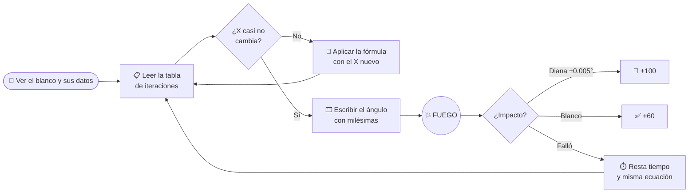

<div align="center">


<a href="https://git.io/typing-svg"></a>

<br/>


**Simulador balístico educativo de Métodos Numéricos**
*Mira el blanco, halla el ángulo, aplica Newton-Raphson y no falles.*

[🎮 Jugar](#-cómo-ejecutarlo) · [🕹️ Cómo se juega](#️-así-se-juega) · [📐 Matemática](#-la-matemática-detrás) · [🏆 Puntos](#-puntuación-y-reloj) · [🎈 Ayudas](#-pistas-y-globos) · [⌨️ Controles](#️-controles) · [🏅 Ranking](#-clasificación)

</div>

---

## 🎯 ¿De qué trata?

**Artillery Calculation** es un juego de puntería donde la fuerza bruta no basta: cada disparo es un problema de **búsqueda de raíces**. Tu cañón dispara con una velocidad fija hacia un blanco (un dron, un radar, un puente, un tanque...) y tú debes encontrar el **ángulo** que hace pasar la bala por el centro del objetivo.

La herramienta es matemática real: el método de **Newton-Raphson**. Una tabla de iteraciones te muestra cómo converge el ángulo, y una de sus filas guarda la respuesta. ¿Sabrás leerla?

> 💡 Todo el juego está hecho en **Pygame** y corre en el navegador con **Pygbag y WebAssembly**. Vercel lo sirve como sitio estático: sin servidor de juego y sin base de datos.

---

## 🕹️ Así se juega



1. 👀 **Mira el blanco**: puede estar cerca o lejos, arriba o abajo, a tu derecha o a tu izquierda.
2. 📊 **Lee los datos** del panel superior: velocidad `v₀`, distancia `D`, gravedad `g` y altura `h`.
3. 🧮 **Itera con Newton-Raphson** usando `f(X)` y `f'(X)`, que el juego te muestra con sus números.
4. 🎯 **Dispara** con el ángulo que ya no cambia. Si fallas, la **ecuación se mantiene** y vuelves a intentarlo.

---

## 📐 La matemática detrás

`f(X)` mide **cuánto falla la bala en altura** al llegar al blanco. Cuando `f(X) = 0`, la bala pasa por el centro. Newton-Raphson corrige el ángulo de prueba paso a paso:

<div align="center">

```
              f(Xₙ)
Xₙ₊₁  =  Xₙ − ───────
              f'(Xₙ)
```

</div>

| Dato | Significado | Unidad |
|:---:|:---|:---:|
| `X` | Ángulo del cañón (la incógnita) | grados |
| `D` | Distancia horizontal al blanco | m |
| `h` | Altura del blanco respecto al cañón | m |
| `v₀` | Velocidad inicial de la bala | m/s |
| `g` | Gravedad | `9.81 m/s²` |
| `c` | `g·D² / (2·v₀²)` | m |

```
f(X)  = D·tan X − c·sec²X − h
f'(X) = sec²X · (D − 2c·tan X)
```

<details>
<summary><b>🔍 Ejemplo resuelto: D = 500 m · v₀ = 100 m/s · h = 0</b></summary>

<br/>

Aquí `c = 122.625` y la semilla es `X₀ = 10°`:

| n | Xₙ (°) | f(Xₙ) | f'(Xₙ) |
|:-:|:-:|:-:|:-:|
| 0 | 10.00000 | −38.2741 | 470.957 |
| 1 | 14.65636 | −0.2468 | 465.672 |
| 2 | **14.68672** | −0.0000 | 465.652 |

Cuando `Xₙ` ya no cambia en los tres decimales, ese valor es tu ángulo: **14.687°**. Si el blanco está a tu izquierda, el ángulo se mide desde la derecha y la respuesta es `180° − X`.

</details>

### Detalles del modelo

| Concepto | Valor |
|---|---|
| Rango de ángulo | `0°` a `180°` (`0°` derecha · `90°` arriba · `180°` izquierda) |
| Distancia al blanco | `100 m` a `1000 m` |
| Tipos de tiro | **Bajo** y **alto** (la bala cae casi vertical) |
| Tolerancia de diana | **±0.005°** |
| Fila con la respuesta | Cambia al azar entre las filas de la tabla |
| Si fallas | La ecuación **no cambia** |

---

## 🗺️ Escenarios

Cada ronda genera un reto con terreno y objetivo aleatorios:

| Terreno | Objetivos posibles |
|---|---|
| 🟩 **Plano** | Dron enemigo · Antena de radio · Práctica de tiro · Camión abandonado |
| ⛰️ **Colina** | Radar · Globo vigía · Torre de vigía · Faro enemigo |
| 🕳️ **Valle** | Bodega escondida · Puente enemigo · Campamento · Tanque atascado |
| 🏔️ **Cumbre** | Antena en la cumbre · Nido de águilas · Torre de control · Observatorio |

---

## 🏆 Puntuación y reloj

<div align="center">

| Resultado | Puntos | Cómo se logra |
|:---:|:---:|:---|
| 🥇 **DIANA PERFECTA** | **+100** | Error de ángulo ≤ **0.005°** |
| 🎯 **BLANCO TOCADO** | **+60** | La bala impacta el objetivo |
| 😬 **CASI** | 0 | Pasó muy cerca, pero no tocó |
| ❌ **FALLASTE** | 0 | Bala perdida |

**Máximo posible:** `10 rondas × 100 = 1000 puntos`

</div>

Cada pista normal y cada fallo reducen el multiplicador de puntos **10 %**; nunca baja de **20 %**. Una pista gratis de un globo no lo reduce. El globo **×2** duplica el siguiente acierto.

### ⏱️ Reloj

- La partida dura **10 minutos** y tiene **10 rondas**.
- **Acertar nunca descuenta tiempo.**
- Cada fallo resta más que el anterior:

```
1.er fallo → −10 s     2.º fallo → −15 s     3.er fallo → −20 s  ...  (tope: −60 s)
```

---

## 💡 Pistas y globos

### 💡 Bombilla

La **bombilla** (o la tecla `Tab`) ofrece hasta **7 pistas por ecuación**, una cada **15 segundos**. Revelan la tabla de Newton-Raphson poco a poco, desde una explicación general hasta la fila con la respuesta. Tras varios fallos también pueden aparecer **consejos tácticos**.

### 🎈 Globos de ayuda

Después de **3 o más fallos** pueden aparecer globos. Duran **30 segundos**: atraviesa uno con la bala para activar su bonificación. Pueden aparecer varios a la vez.

| Globo | Efecto |
|:---:|:---|
| 🟡 **Doble** | **×2 puntos** en tu próximo acierto |
| 🔵 **Congelar** | Detiene el reloj **20 s**; se acumula hasta **60 s** |
| 🟢 **Tiempo** | Añade **45 s** (el reloj no supera los **10 minutos**) |
| 🟠 **Pista** | Revela una pista **sin reducir el multiplicador** |

> 🛡️ Si recoges un globo durante un disparo fallido, se evita la penalización de tiempo de ese fallo.

---

## ⌨️ Controles

| Acción | Mouse / Touch | Teclado |
|---|:---:|:---:|
| Iniciar partida | Botón **▶ Jugar** | `Enter` |
| Disparar | Botón **Disparar** | `Enter` |
| Repetir disparo | Esperar la cuenta atrás de **3 s** | — |
| Pedir pista | Icono 💡 | `Tab` |
| Acelerar la bala en vuelo (×4) | Clic mientras viaja | — |
| Mostrar u ocultar el teclado en pantalla | Icono de teclado | — |
| Silenciar o activar la música | Botón del altavoz | — |
| Volver al inicio durante la partida | Icono de la casita | — |
| Siguiente ecuación | Botón | `Enter` (tras acertar) |
| Volver al menú | Botón **Menú** | `Esc` |
| Guardar puntuación | Botón **Guardar** | `Enter` |
| Pantalla completa en escritorio | — | `F11` |

<details>
<summary><b>🔢 Teclado en pantalla</b></summary>

<br/>

- Empieza **oculto**: solo aparece cuando pulsas el **icono de teclado** de la barra superior, junto al audio y a la casita.
- Escribe el ángulo con sus teclas, **BORRAR** limpia el campo y **DISPARAR** lanza el tiro.
- **Arrástralo** desde su encabezado (los puntitos de la derecha) a cualquier zona del juego: se queda donde lo dejes.
- Vuelve a pulsar el icono para ocultarlo.

</details>

<details>
<summary><b>📱 Móviles y pantalla</b></summary>

<br/>

- El juego se adapta al área visible y conserva su proporción, sin pedir pantalla completa al navegador.
- Toca el campo del nombre para abrir el teclado de texto; el campo del ángulo abre el teclado decimal y acepta valores entre `0°` y `180°`.
- En vertical, **Girar pantalla** solicita el giro automático y, si el navegador no lo permite, rota el juego dentro del área visible.
- La resolución de render se ajusta al tamaño, la densidad y la capacidad del dispositivo, hasta **1280×720**.
- En escritorio inicia en pantalla completa y escala el lienzo; `F11` alterna el modo.
- Durante la carga se muestra el progreso de descarga y el avance de preparación.

</details>

<details>
<summary><b>🎨 Calidad gráfica y menú</b></summary>

<br/>

El menú principal muestra el **Top 4** por promedio de puntos. Sus pestañas permiten ver las instrucciones, la clasificación completa y el ajuste **Bajo / Medio / Alto**, que reduce o activa partículas, brillos y capas animadas. La preferencia se guarda para la próxima visita. Las instrucciones se desplazan con la rueda del mouse o deslizando dentro del panel.

</details>

<details>
<summary><b>🎵 Música y efectos</b></summary>

<br/>

- Banda sonora electrónica suave **sintetizada localmente**, con variaciones aleatorias de tempo, armonía y melodía, sin archivos de audio.
- En navegadores comienza tras la primera interacción y la genera el propio navegador con **WebAudio**: no consume CPU de Python, se pausa al cambiar de pestaña y mantiene el equipo fresco.
- El altavoz muestra ondas cuando suena y una marca de silencio cuando está apagado; la preferencia se guarda en el dispositivo.
- Los efectos de impacto suenan justo cuando termina la trayectoria y tienen un tono distinto para diana, blanco tocado, casi acierto y fallo lejano.

</details>

---

## 🏅 Clasificación

Al terminar puedes guardar tu nombre (hasta **14 caracteres**) y competir en el ranking local. Se ordena por **promedio de puntos por partida** y muestra:

`PART.` partidas · `ACIER.` aciertos · `ERR.` errores · `A/E` razón aciertos/errores · `PROM.` promedio

> 🔒 En el navegador, el ranking se guarda en cookies locales: es privado, no usa servidor ni base de datos y **no se comparte** entre dispositivos. Cada nombre se registra **una sola vez**.

---

## 🚀 Cómo ejecutarlo

Usa un entorno virtual para no modificar el Python del sistema:

```bash
python -m venv .venv
.venv\Scripts\python.exe -m pip install -r requirements.txt
.venv\Scripts\python.exe build_web.py
.venv\Scripts\python.exe -m http.server 8000 --directory web_build/build/web
```

Abre `http://localhost:8000`. En macOS/Linux sustituye `.venv\Scripts\python.exe` por `.venv/bin/python`.

Versión de escritorio:

```bash
.venv\Scripts\python.exe main.py
```

### 🌐 Publicar en Vercel

Importa el repositorio en Vercel y conserva la configuración de `vercel.json`. El proceso crea un entorno virtual `.vercel-venv`, instala las dependencias, ejecuta Pygbag y publica `web_build/build/web` como sitio estático. No hace falta función backend ni base de datos.

---

## 📁 Estructura del proyecto

```
📦 artillery-calculation
 ┣ 📜 main.py                   ← punto de entrada para escritorio y web
 ┣ 📜 artillery_calculation.py ← lógica del juego, física, interfaz y animaciones
 ┣ 📜 build_web.py              ← crea el paquete web con Pygbag
 ┣ 📜 requirements.txt          ← dependencias de escritorio y compilación web
 ┣ 📜 vercel.json               ← compilación y publicación estática en Vercel
 ┣ 📄 index.html                ← plantilla web generada por Pygbag
 ┣ 📁 assets/
 ┃ ┗ 🖼️ favicon.png             ← icono web
 ┣ 📁 save_prof/                ← puntuaciones locales de escritorio
 ┣ 📁 web_build/                ← paquete web generado
 ┗ 📘 README.md
```

---

## 🛠️ Hecho con

- **Pygame y Pygbag/WebAssembly** para ejecutar el juego dentro del navegador.
- **Bucle asíncrono** limitado a 60 FPS, con un regulador automático que baja o sube los efectos para no caer de 30 FPS en ninguna calidad gráfica.
- **Escalado de un solo paso** al tamaño de la pantalla, con suavizado para conservar nítidos textos, números y símbolos.
- **Vercel estático** para publicar los archivos compilados.
- **Newton-Raphson** para las iteraciones de la tabla.
- **Escalado adaptable** al tamaño de la ventana y a la densidad de píxeles.

---

## 🎓 Objetivo educativo

Muestra de forma lúdica que un método numérico **converge**: cada iteración acerca el valor a la raíz. Quien juega aprende a **leer una tabla de iteraciones**, a reconocer cuándo `X` deja de cambiar y a afinar la respuesta con la precisión que exige la tolerancia.

<div align="center">

<br/>

**¿Listo para no fallar?** 🎯


</div>
