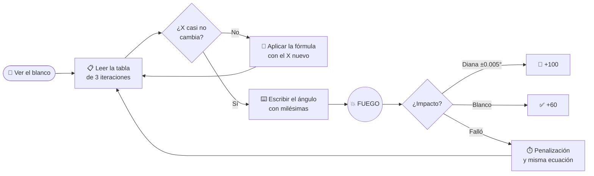

<div align="center">


<a href="https://git.io/typing-svg"></a>

<br/>


**Simulador balístico educativo de Métodos Numéricos**
*Mira el blanco, halla el ángulo, aplica Newton-Raphson y no falles.*

[🎮 Jugar](#-c%C3%B3mo-ejecutarlo) · [📐 La matemática](#-la-matem%C3%A1tica-detr%C3%A1s) · [🏆 Puntuación](#-puntuaci%C3%B3n) · [🎈 Globos](#-globos-de-ayuda) · [⌨️ Controles](#%EF%B8%8F-controles)

</div>

---

## 🎯 ¿De qué trata?

**Artillery Calculation** es un juego de puntería donde la fuerza bruta no basta: cada disparo es un problema de **búsqueda de raíces**. El cañón dispara una bala con velocidad fija hacia un blanco (un dron, un radar, un puente, un tanque...) y tú debes encontrar el **ángulo** que hace que la bala pase exactamente por el centro del objetivo.

Para lograrlo, el juego te da una herramienta de las matemáticas reales: el método de **Newton-Raphson**. Una tabla con **3 iteraciones** te muestra cómo converge el ángulo, y una de esas filas guarda la respuesta correcta. ¿Sabrás leerla?

> 💡 El juego conserva su implementación completa en Pygame y se ejecuta en el navegador mediante **Pygbag y WebAssembly**. Vercel sirve el resultado como un sitio estático, sin servidor de juego ni base de datos. El navegador necesita conexión a internet para descargar el runtime WebAssembly.

---

## 🧮 La matemática detrás

La función `f(X)` mide **cuánto falla la bala en altura** al llegar al blanco. Cuando `f(X) = 0`, la bala pasa por el centro. Newton-Raphson corrige el ángulo de prueba paso a paso:

<div align="center">

```
              f(Xₙ)
Xₙ₊₁  =  Xₙ − ───────
              f'(Xₙ)
```

</div>



### Detalles del modelo

| Concepto | Valor |
|---|---|
| Gravedad | `9.81 m/s²` |
| Rango de ángulo | `1°` a `180°` (el blanco puede estar a tu **izquierda**) |
| Distancia al blanco | `100 m` a `1000 m` |
| Tipos de tiro | **Bajo** y **alto** (la bala cae casi vertical) |
| Tolerancia de diana | **±0.005°** |
| Retos con la misma ecuación | Si fallas, la ecuación **no cambia**: intentas otra vez |

---

## 🗺️ Escenarios

Cada ronda genera un reto distinto con un terreno y un objetivo aleatorios:

| Terreno | Objetivos posibles |
|---|---|
| 🟩 **Plano** | Dron enemigo · Antena de radio · Práctica de tiro · Camión abandonado |
| ⛰️ **Colina** | Radar · Globo vigía · Torre de vigía · Faro enemigo |
| 🕳️ **Valle** | Bodega escondida · Puente enemigo · Campamento · Tanque atascado |
| 🏔️ **Cumbre** | Antena en la cumbre · Nido de águilas · Torre de control · Observatorio |

---

## 🏆 Puntuación

<div align="center">

| Resultado | Puntos | Cómo se logra |
|:---:|:---:|:---|
| 🥇 **DIANA PERFECTA** | **+100** | Error de ángulo ≤ **0.005°** |
| 🎯 **BLANCO TOCADO** | **+60** | La bala impacta el objetivo |
| 😬 **CASI** | 0 | Pasó muy cerca, pero no tocó |
| ❌ **FALLASTE** | 0 | Bala perdida |

**Máximo posible:** `10 rondas × 100 = 1000 puntos`

</div>

### ⏱️ Reloj

- La partida dura **10 minutos** y consta de **10 rondas**.
- **Acertar nunca descuenta tiempo.**
- Cada fallo resta tiempo de forma progresiva:

```
1.er fallo → −10 s     2.º fallo → −15 s     3.er fallo → −20 s  ...  (tope: −60 s)
```

---

## 💡 Sistema de pistas

La **bombilla** te ofrece hasta **7 pistas por partida** (1 cada 15 segundos). Van de lo general a lo específico:

1. 🔎 Entiende qué mide `f(X)`
2. 🌱 Usa la semilla `X₀`
3. 🧮 Primera corrección con la fórmula
4. 🔁 Sigue iterando
5. 📍 Casi converge: te acota el ángulo entre dos grados
6. ... hasta revelar la fila de la tabla que guarda la respuesta

Además, tras varios fallos el juego puede darte **consejos** automáticos, por ejemplo: *«Corrige solo la mitad de lo que te equivocaste»* o *«Medio grado ya mueve la bala varios metros»*.

---

## 🎈 Globos de ayuda

Si fallas **3 veces o más**, pueden aparecer **globos** en el campo. **Atraviésalos con la trayectoria de tu bala** para activar su efecto:

| Globo | Efecto |
|:---:|:---|
| 🟡 **Doble** | **×2 puntos** en tu próximo acierto |
| 🔵 **Congelar** | **Congela el reloj 20 s** (sin penalizaciones mientras dure) |
| 🟢 **Tiempo** | **+45 s** al reloj |
| 🟠 **Pista** | **Una pista gratis** |

---

## ⌨️ Controles

| Acción | Mouse / Touch | Teclado |
|---|:---:|:---:|
| Iniciar partida | Botón **▶ Jugar** | `Enter` |
| Disparar | Botón **Disparar** | `Enter` |
| Repetir disparo | Esperar la cuenta atrás de **3 segundos** | — |
| Pedir pista (bombilla) | Icono 💡 | `Tab` |
| Siguiente ecuación | Botón | `Enter` (tras acertar) |
| Volver al menú | Botón **Menú** | `Esc` |
| Guardar puntuación | Botón **Guardar** | `Enter` |

> 📱 Funciona en **escritorio y móvil**: el lienzo se escala automáticamente a cualquier pantalla.

En móviles, el juego recomienda usar el teléfono en horizontal. Pulsa **Girar pantalla automáticamente** para que el navegador solicite el giro y pantalla completa; si el navegador o el dispositivo no lo permiten, gíralo manualmente. La versión web limita el juego a 30 FPS para reducir el consumo de batería y carga del dispositivo.

---

## 🏅 Clasificación

Al terminar puedes guardar tu nombre (hasta **14 caracteres**) y competir en el ranking local. Se ordena por **promedio de puntos por partida** y muestra:

`PART.` partidas · `ACIER.` aciertos · `ERR.` errores · `A/E` razón aciertos/errores · `PROM.` promedio

> 🔒 En el navegador, el ranking se guarda en cookies locales: es privado, no usa servidor ni base de datos y **no se comparte** entre dispositivos. Cada nombre se registra **una sola vez**.

---

## 🚀 Cómo ejecutarlo

Para preparar la versión web, usa un entorno virtual para no modificar el Python del sistema:

```bash
python -m venv .venv
# Windows
.venv\Scripts\python.exe -m pip install -r requirements.txt
.venv\Scripts\python.exe build_web.py
.venv\Scripts\python.exe -m http.server 8000 --directory web_build/build/web
# Abre http://localhost:8000
```

En macOS/Linux, sustituye `.venv\Scripts\python.exe` por `.venv/bin/python`.

También puedes ejecutar la versión de escritorio:

```bash
.venv\Scripts\python.exe artillery_calculation.py
```

### 🌐 Publicar en Vercel

Importa el repositorio en Vercel y conserva la configuración de compilación detectada desde `vercel.json`. El proceso crea un entorno virtual `.vercel-venv` para instalar las dependencias sin modificar el Python administrado por Vercel, ejecuta Pygbag y publica `web_build/build/web` como sitio estático. No se requiere una función backend ni una base de datos.

---

## 📁 Estructura del proyecto

```
📦 artillery-calculation
 ┣ 📜 artillery_calculation.py  ← juego, física, interfaz y animaciones
 ┣ 📜 main.py                   ← punto de entrada web de Pygbag
 ┣ 📜 requirements.txt          ← dependencias de escritorio y compilación web
 ┣ 📜 build_web.py              ← crea un paquete web aislado del guardado local
 ┣ 📜 vercel.json               ← compilación y publicación estática en Vercel
 ┣ 🖼️ logo.ico                  ← logo original
 ┣ 🖼️ favicon.png               ← icono de pestaña del juego web
 ┣ 📁 web_build/                ← paquete web generado (no se sube como fuente)
 ┗ 📘 README.md
```

> ⚠️ Mantén `favicon.png` en la raíz del proyecto para que Pygbag lo incluya en la pestaña del juego.

---

## 🛠️ Hecho con

- **Pygame y Pygbag/WebAssembly** para conservar el juego y ejecutarlo dentro del navegador.
- **Bucle asíncrono sincronizado con el navegador** para ceder el control entre cuadros y mantener la interfaz fluida.
- **Vercel estático** para publicar los archivos compilados; no hay servidor de partidas.
- **Newton-Raphson** para la derivada numérica y las iteraciones mostradas en la tabla.
- **Escalado adaptable** al tamaño de la ventana y a la densidad de píxeles.

---

## 🎓 Objetivo educativo

Este proyecto muestra de forma lúdica que un método numérico **converge**: cada iteración acerca el valor a la raíz, y el estudiante aprende a **leer una tabla de iteraciones**, reconocer cuándo `X` deja de cambiar y afinar la respuesta con la precisión que exige la tolerancia.

<div align="center">

<br/>

**¿Listo para no fallar?** 🎯


</div>
